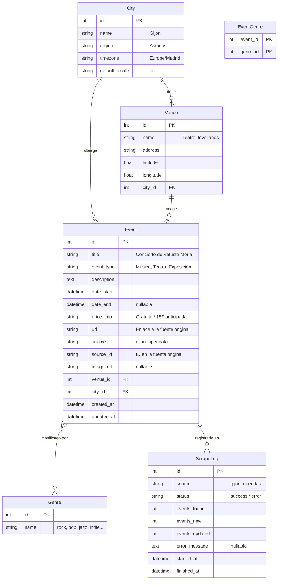

# Modelo de Datos

> **Objetivo:** Definir las entidades, sus atributos, relaciones y el esquema de base de datos que las soporta.

---

## Diagrama Entidad-Relación



---

## Descripción de Entidades

### City (Ciudad)

Representa una ciudad para la que se agregan eventos.

| Campo | Tipo | Descripción |
|-------|------|-------------|
| `id` | int (PK) | Identificador único |
| `name` | string | Nombre de la ciudad (ej: "Gijón") |
| `region` | string | Región (ej: "Asturias") |
| `timezone` | string | Zona horaria IANA (ej: "Europe/Madrid") |
| `default_locale` | string | Idioma por defecto: "es" o "ast" |

### Venue (Sala/Espacio)

Lugar donde se celebra un evento.

| Campo | Tipo | Descripción |
|-------|------|-------------|
| `id` | int (PK) | Identificador único |
| `name` | string | Nombre del espacio (ej: "Teatro Jovellanos") |
| `address` | string | Dirección postal |
| `latitude` | float | Latitud (nullable) |
| `longitude` | float | Longitud (nullable) |
| `city_id` | int (FK) | Referencia a `City` |

### Event (Evento)

El núcleo del sistema. Un concierto, obra de teatro, exposición...

| Campo | Tipo | Descripción |
|-------|------|-------------|
| `id` | int (PK) | Identificador único |
| `title` | string | Título del evento |
| `event_type` | string | Tipo: "Música", "Teatro", "Exposición", etc. |
| `description` | text | Descripción larga (nullable) |
| `date_start` | datetime | Fecha y hora de inicio |
| `date_end` | datetime | Fecha y hora de fin (nullable — mismo día si no se especifica) |
| `price_info` | string | Información de precio en texto libre (nullable) |
| `url` | string | URL a la página oficial del evento |
| `source` | string | Origen de los datos: "gijon_opendata", "ticketera_x"... |
| `source_id` | string | ID del evento en la fuente original (para deduplicación) |
| `image_url` | string | URL de la imagen del evento (nullable) |
| `venue_id` | int (FK) | Referencia a `Venue` |
| `city_id` | int (FK) | Referencia a `City` (denormalizado para consultas frecuentes) |
| `created_at` | datetime | Marca de creación |
| `updated_at` | datetime | Marca de última actualización |

### Genre (Género Musical)

Etiqueta para clasificar eventos musicales.

| Campo | Tipo | Descripción |
|-------|------|-------------|
| `id` | int (PK) | Identificador único |
| `name` | string | Nombre del género: "rock", "pop", "jazz", "indie"... |

### EventGenre (Relación N:M)

| Campo | Tipo | Descripción |
|-------|------|-------------|
| `event_id` | int (PK, FK) | Referencia a `Event` |
| `genre_id` | int (PK, FK) | Referencia a `Genre` |

### ScrapeLog (Registro de Scraping)

Trazabilidad de cada ejecución de scraper.

| Campo | Tipo | Descripción |
|-------|------|-------------|
| `id` | int (PK) | Identificador único |
| `source` | string | Fuente scrapeada |
| `status` | string | "success" o "error" |
| `events_found` | int | Total de eventos encontrados en la fuente |
| `events_new` | int | Eventos nuevos insertados |
| `events_updated` | int | Eventos existentes actualizados |
| `error_message` | text | Mensaje de error si `status` = "error" |
| `started_at` | datetime | Inicio de la ejecución |
| `finished_at` | datetime | Fin de la ejecución |

---

## Estrategia de Deduplicación

**Clave natural de un evento:**

```
source + source_id
```

Si la fuente no proporciona un ID único, se usa una clave compuesta:

```
title + date_start + venue_id + city_id
```

El scraper, antes de insertar:
1. Busca si existe un evento con el mismo `source + source_id`
2. Si existe → actualiza campos que puedan haber cambiado (precio, descripción)
3. Si no existe → INSERT

---

## Notas de Diseño

- `city_id` está denormalizado en `Event` para evitar joins innecesarios en la consulta más frecuente: "eventos en ciudad X entre fecha A y B".
- `event_type` es un string, no un enum en BD. La validación la hace el dominio (Pydantic). Esto permite añadir tipos nuevos sin migración de esquema.
- `genre` es una tabla separada en lugar de un string en `Event` porque queremos búsquedas precisas por género. Si el scraper no clasifica géneros automáticamente, se deja la relación vacía y se añade en el futuro.
- Las coordenadas de `Venue` son opcionales porque no todas las fuentes las proporcionan. Si en el futuro se añade geobúsqueda ("conciertos cerca de mí"), se pueden geocodificar los venues sin coordenadas.

---

> **Siguiente lectura recomendada:** [[04_Tools_del_LLM]]
