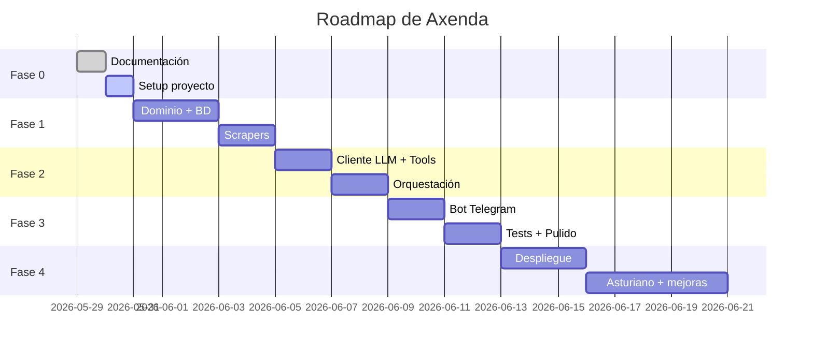

# Roadmap de Axenda

> **Objetivo:** Planificar las fases del proyecto con hitos concretos y criterios de completado.

---

## Fase 0: Documentación y Setup — ✅ COMPLETADA

**Objetivo**: Definir la arquitectura, stack tecnológico y estructura del proyecto antes de escribir una sola línea de código.

| Tarea | Estado |
|-------|--------|
| [[00_README]] | ✅ Completado |
| [[01_Arquitectura_General]] | ✅ Completado |
| [[02_Decisiones_Tecnicas]] | ✅ Completado |
| [[03_Modelo_de_Datos]] | ✅ Completado |
| [[04_Tools_del_LLM]] | ✅ Completado |
| [[05_Estrategia_Scraping]] | ✅ Completado |
| [[06_Estrategia_Multilingue]] | ✅ Completado |
| [[07_Guia_Desarrollo]] | ✅ Completado |
| [[08_Roadmap]] | ✅ Completado |
| Crear repositorio Git en `~/oscgf/github/axenda` | ✅ Completado |
| Inicializar proyecto con Poetry | ✅ Completado |

---

## Fase 1: Dominio + Scrapers + Base de Datos — ✅ COMPLETADA

**Objetivo**: Tener datos reales de eventos en una base de datos consultable.

**Criterio de completado**: Ejecutar `scripts/run_scrapers.py` y ver eventos de Gijón en la BD. ✓ 191 eventos ingeridos. 29 tests pasan.

| Tarea                                                                | Dependencia  | Estado |
| -------------------------------------------------------------------- | ------------ | ------ |
| Crear estructura de carpetas `src/axenda/`                           | Fase 0       | ✅ |
| Implementar entidades de dominio (Event, Venue, City, value objects) | —            | ✅ |
| Implementar interfaces de repositorio (ABC)                          | —            | ✅ |
| Configurar SQLAlchemy + Alembic                                      | —            | ✅ |
| Crear modelos ORM y migración inicial                                | Entidades    | ✅ |
| Implementar repositorios SQL                                         | ABC + ORM    | ✅ |
| Refactorizar [[base_script]] como scraper con el patrón BaseScraper  | ABC scraper  | ✅ |
| Implementar `run_scrapers.py`                                        | Scraper + BD | ✅ |
| Escribir tests de dominio                                            | Entidades    | ✅ |
| Escribir tests de repositorios                                       | Repos SQL    | ✅ |

---

## Fase 2: Capa LLM + Tools — ✅ COMPLETADA

**Objetivo**: Que el LLM pueda traducir lenguaje natural a tool calls y formatear respuestas.

**Criterio de completado**: Poder ejecutar un script de prueba que reciba una pregunta en texto y devuelva resultados de la BD formateados. ✓ 42 tests. Modelo: llama3.2:3b (2.7s/respuesta).

| Tarea | Dependencia | Estado |
|-------|------------|--------|
| Configurar cliente de Ollama | Fase 1 | ✅ |
| Implementar definiciones de tools (Pydantic) | [[04_Tools_del_LLM]] | ✅ |
| Implementar system prompts (ES) | [[06_Estrategia_Multilingue]] | ✅ |
| Implementar caso de uso `SearchEvents` | Tools + Repos | ✅ |
| Implementar orquestación LLM → tool call → BD → formateo | SearchEvents | ✅ |
| Escribir tests de tools (unitarios) | Tools | ✅ |
| Escribir tests de integración LLM (con mocks) | Orquestación | ✅ |
| Normalización de ciudad (acentos) | — | ✅ |
| Formato estructurado (📅 + 🔗 url) | — | ✅ |
| Script chat.py interactivo | — | ✅ |

---

## Fase 3: Bot de Telegram — ✅ COMPLETADA

**Objetivo**: Un bot de Telegram funcional que responda a preguntas sobre conciertos.

**Criterio de completado**: Hablar con el bot por Telegram y recibir respuestas correctas. ✓ Bot funcionando en @ogf_axenda_bot. 48 tests.

| Tarea | Dependencia | Estado |
|-------|------------|--------|
| Configurar PTB Application | Fase 2 | ✅ |
| Implementar handler de mensajes (`/start`, texto libre) | PTB | ✅ |
| Integrar handler con caso de uso `SearchEvents` | Handler + CU | ✅ |
| Implementar comandos: `/start`, `/help`, `/idioma` | — | ✅ |
| Manejo de errores y timeouts (el LLM puede tardar) | Handler | ✅ |
| Escribir tests del bot (con mocks de Telegram) | Handlers | ✅ |
| Makefile (make bot, make chat, make test...) | — | ✅ |

---

## Fase 4: Producción y Mejoras

**Objetivo**: Bot estable, desplegado, con soporte bilingüe y lista para escalar.

| Tarea | Dependencia | Estado |
|-------|------------|--------|
| Despliegue en servidor (Raspberry Pi, VPS, Fly.io...) | Fase 3 | ⬜ |
| System prompt en asturiano | [[06_Estrategia_Multilingue]] | ⬜ |
| Comando `/idioma` funcional | Prompt AST | ⬜ |
| Añadir más tipos de evento (teatro, expos...) | Fuente datos | ⬜ |
| Scraper para nueva ciudad (Oviedo, Avilés...) | Fase 1 | ⬜ |
| Interfaz REST con FastAPI | Fase 3 | ⬜ |
| Dashboard web simple para ver eventos | API REST | ⬜ |
| Notificaciones proactivas ("mañana hay concierto de X") | — | ⬜ |

---

## Diagrama de Fases

---

## Notas

- Las estimaciones de tiempo son orientativas. La prioridad es aprender y hacer las cosas bien, no rápido.
- Cada fase se considera completada cuando sus tests pasan y el criterio de completado se cumple.
- La documentación se actualiza al final de cada fase con lo aprendido.

---

> **Fin de la documentación inicial.** Volver a [[00_README]]
